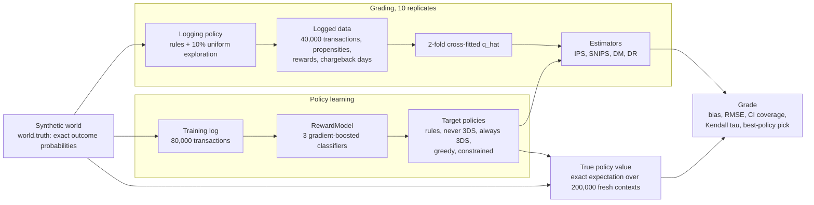
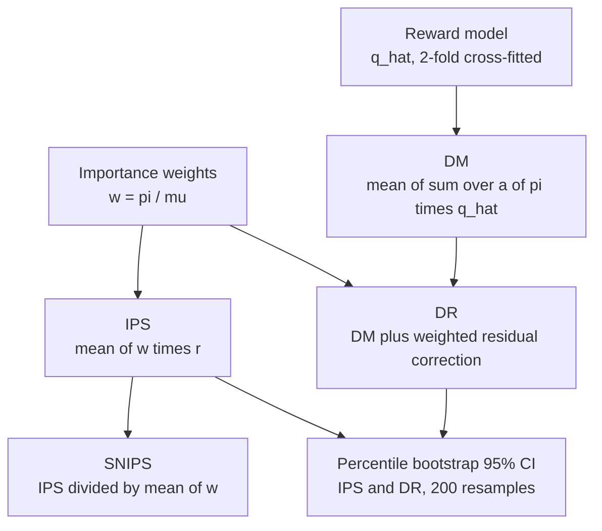
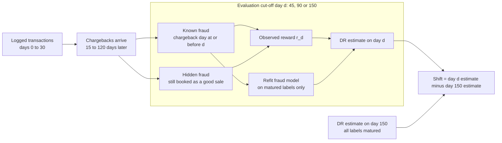

# Arbiter

[](https://github.com/ombdj1209/arbiter/actions/workflows/ci.yml)

**Can we trust the offline number before we ship the payment policy?** A payment decision lab. A synthetic payment world with *known* outcome probabilities (issuer approval, 3-D Secure friction and liability shift, routing cost, fraud with delayed chargebacks) lets every off-policy estimate be graded against the exact truth, not against another estimate.

It learns an unconstrained and a fraud-constrained policy from logged traffic, then measures how well IPS, SNIPS, direct-method and doubly robust estimators value and rank them, and what happens when fraud labels have not matured yet.

All transactions are synthetic. Nothing here claims to reproduce Adyen's data, models or results.

## At a glance

- **Question:** how far off is an offline (off-policy) estimate of a payment policy that has never been deployed, and does it pick the right policy?
- **Method:** a simulator with closed-form outcome probabilities, so the true value of any policy is an exact expectation rather than another estimate.
- **Headline:** the fraud-constrained policy earns 5.0% more per transaction than the rules with 43% less merchant-liable fraud, yet no estimator reliably identifies it offline. The gap between the two model policies is €0.23 per transaction; the estimator error is €0.4 to €0.6.
- **Delayed labels:** evaluate six weeks after logging and you ship the wrong policy in 9 of 10 cases.
- **Footprint:** about 470 lines of Python across three modules and one evaluation script, plus eight tests. The full run takes 112 s on one CPU core. Python 3.11+.

## Tech stack

| Layer | Technology | Used for |
|---|---|---|
| Language | Python 3.11+ | Everything; `from __future__ import annotations` throughout |
| Numerics | NumPy | Vectorised simulator, policies as `(n, 4)` probability matrices, `default_rng` seeded generators, importance weights, bootstrap resampling, percentiles, `geomspace` grid for λ |
| Statistics | SciPy | `scipy.stats.kendalltau` for rank agreement between estimated and true policy values |
| Models | scikit-learn | `HistGradientBoostingClassifier`, three per reward model: abandonment, approval, fraud |
| Standard library | `dataclasses`, `argparse`, `json`, `pathlib`, `time`, `platform`, `html` | Frozen world parameters, `--quick` flag, `results.json`, timing and environment capture, escaped HTML report |
| Testing | pytest | Eight tests on the simulator, estimators, label maturity and constraint tuning |
| Build | setuptools via `pyproject.toml`, Make | Editable install with a `dev` extra; `make install`, `test`, `eval`, `quick` |
| CI and maintenance | GitHub Actions (Python 3.11–3.13), Dependabot | Test matrix on every push; dependency updates |

## Repository layout

```text
arbiter/
├── arbiter/
│   ├── __init__.py
│   ├── world.py        # synthetic payment world: contexts, true probabilities, exact policy value, logged outcomes
│   ├── lab.py          # policies, decomposed reward model, IPS / SNIPS / DM / DR, bootstrap CIs
│   └── report.py       # self-contained HTML report from results.json
├── tests/
│   └── test_arbiter.py # 8 tests
├── results/
│   ├── results.json    # committed output of the full run; source of every number below
│   └── report.html
├── run_eval.py         # end-to-end experiment; reproduces every number in this README
├── pyproject.toml
├── Makefile
├── SECURITY.md
└── LICENSE
```

## Why this exists

Adyen describes its payment AI as a connected decision chain covering risk, authentication, authorisation, routing, retries and cost, optimised together and evaluated counterfactually. Its Uplift product balances conversion, fraud and cost, and Adyen has said it sometimes advises merchants to accept more fraud for a better bottom line. Every one of those decisions depends on one question: **how much can you trust an offline estimate of a policy you have not deployed?** With real data you can never know. Here you can.

## Evaluation architecture



## The world

Each transaction gets one of four actions: route A or B, with or without 3DS.

| Effect | Model |
|---|---|
| 3DS friction | 5% to 21% abandonment, higher on mobile, new shoppers and small baskets |
| 3DS approval lift | Issuers approve authenticated transactions more often |
| 3DS against fraud | 85% of fraudsters fail authentication; liability shifts to the issuer |
| Routing | Route B costs more per transaction but suits some issuers better |
| Fraud | Depends on country risk, new shopper, amount, velocity and time of day |
| Chargebacks | Arrive 15 to 120 days after the transaction |

Logged traffic comes from a typical rule policy (3DS on amounts over €150 or risky countries, always route A) with 10% uniform exploration and logged propensities.

## Methodology

### How ground truth is obtained

`world.truth` returns, for every context and every action, the exact probabilities of abandonment, approval (separately for legitimate and fraudulent shoppers) and fraud, and from them the expected net reward. `world.policy_value` then computes the value of any stochastic policy π as `mean over x of sum_a π(a|x) · E[r | x, a]`. There is no sampling noise in the truth beyond the finite set of 200,000 contexts it is averaged over. A test confirms that this exact value agrees with a Monte Carlo sample mean to within four standard errors.

Realised outcomes are sampled from the same probabilities (`log_outcomes`), each fraud case gets a chargeback day `transaction day + U(15, 120)`, and transactions are spread uniformly over a 30-day logging window.

### Policies

- **Rules (production):** 3DS if amount > €150 or risky country, always route A. Also the logging policy, mixed as `μ = 0.9 · rules + 0.1 · uniform`.
- **Never 3DS / Always 3DS:** fixed baselines on route A.
- **Model, unconstrained (`greedy`):** `argmax_a q_hat(x, a)` using a reward model trained on the 80,000-transaction log.
- **Model, fraud-constrained (`constrained`):** `argmax_a [q_hat(x, a) − λ · fraud_vol_hat(x, a)]`, a Lagrangian relaxation. `tune_lambda` scans λ = 0 then 60 log-spaced values from 0.01 to 50 and takes the smallest λ whose *predicted* merchant-liable fraud is at or under 12 bps of approved volume.
- **Oracle:** `argmax_a` of the true expected reward; an upper reference, not a candidate.

### Reward model

`RewardModel` mirrors the business decomposition rather than regressing reward directly: `P(abandon | x, 3DS)`, `P(approved | x, a)` and `P(fraud | approved, x, a)`, each a `HistGradientBoostingClassifier`. The fraud model is fitted only on approved transactions whose chargeback window has matured at the evaluation cut-off. Expected net revenue per action is then assembled analytically, including the liability shift under 3DS.

### Estimators

With importance weight `w_i = π(a_i|x_i) / μ(a_i|x_i)`, logged reward `r_i` and cross-fitted reward model `q_hat`:

| Estimator | Formula | Bias | Variance |
|---|---|---|---|
| IPS | `mean(w_i · r_i)` | Unbiased if propensities are correct and μ covers π | Highest; explodes when π and μ disagree |
| SNIPS | `sum(w_i · r_i) / sum(w_i)` | Small finite-sample bias, consistent | Lower than IPS; bounded by the reward range |
| DM | `mean over i of sum_a π(a|x_i) · q_hat(x_i, a)` | Inherits all reward-model bias | Lowest; ignores logged rewards beyond fitting |
| DR | `DM + mean(w_i · (r_i − q_hat(x_i, a_i)))` | Unbiased if either propensities or q_hat are correct | Between DM and IPS; small when q_hat is good |



Effective sample share is Kish's `(sum w)² / (n · sum w²)`: the fraction of the log that effectively informs a given target policy.

## Results

`python run_eval.py`: 112 s on one CPU core. Policies are learned from 80,000 logged transactions. True values are exact expectations over 200,000 fresh transactions. Estimators are graded on 10 independent logs of 40,000 transactions each, with 2-fold cross-fitted reward models.

### True value of each policy

| Policy | Net € per transaction | Conversion | Merchant-liable fraud | 3DS rate |
|---|---|---|---|---|
| Rules (production) | 13.190 | 80.1% | 59.2 bps | 26% |
| Never 3DS | 12.512 | 81.2% | 192.1 bps | 0% |
| Always 3DS | 13.303 | 76.3% | 0.0 bps | 100% |
| Model, unconstrained | 13.615 | **84.9%** | 123.8 bps | 28% |
| **Model, fraud-constrained (budget 12 bps predicted)** | **13.848** | 81.3% | 33.5 bps | 75% |
| Oracle (knows the true probabilities) | 14.134 | 84.7% | 54.2 bps | 52% |

The constrained policy earns **5.0% more per transaction than the rules, with 43% less merchant-liable fraud.** It also beats the unconstrained model. The unconstrained model maximises its own *predicted* revenue, keeps 3DS on only 28% of traffic to protect conversion, and pays for it in fraud that its model underestimates. The constraint acts as a guardrail on model error, not just a compliance cost. (The realised fraud rate, 33.5 bps, is above the 12 bps the model predicted: the model is optimistic about fraud, which is exactly the failure the guardrail limits.)

### Would the offline estimate have told you that?

| Policy | Effective sample | IPS bias | SNIPS bias | DM bias | DR bias | DR RMSE | DR 95% CI coverage |
|---|---|---|---|---|---|---|---|
| Rules (production) | 92.4% | −0.016 | −0.004 | +0.085 | +0.004 | 0.071 | 100% |
| Always 3DS | 3.4% | +0.050 | −0.075 | −0.130 | +0.024 | 0.221 | 80% |
| Never 3DS | 9.1% | +0.607 | +0.616 | +0.606 | +0.456 | 0.680 | 80% |
| Model, unconstrained | 2.9% | +0.314 | +0.155 | +0.035 | −0.093 | 0.645 | 90% |
| Model, constrained | 2.8% | +0.209 | −0.035 | −0.217 | −0.187 | 0.403 | 100% |

(Bias and RMSE in euro per transaction. Effective sample is the share of logged transactions that effectively count, from the importance weights.)

| Estimator | Kendall τ with the true ranking | Picked the truly best policy |
|---|---|---|
| IPS | 0.42 | 40% |
| SNIPS | 0.24 | 20% |
| Direct method | 0.50 | 50% |
| Doubly robust | 0.50 | 20% |

**The gap between the two model policies is €0.23 per transaction; the estimator error is €0.4 to €0.6.** With 10% exploration spread over four actions, a policy that disagrees with production on most traffic keeps under 3% effective sample. Even with every label matured, no estimator reliably picks the right policy, and the doubly robust estimate prefers the worse, unconstrained one in 60% of logs. This is the concrete version of *why the globally optimal payment policy can look worse offline but be better online*.

### Delayed fraud labels

The same logs, re-estimated with only the chargebacks known by each day. The shift is the DR estimate on that day minus the fully matured estimate, averaged over 10 logs.



At each cut-off, `observed_reward` replaces the reward of any fraud case without a chargeback by the reward of a legitimate sale, the reward model is re-cross-fitted with only matured fraud labels, and DR is recomputed for the rules, unconstrained and constrained policies. Day 150 reuses the fully matured model.

| Evaluation day | Fraud labels known | Shift, unconstrained | Shift, constrained | Shift, rules | Logs where unconstrained looks better |
|---|---|---|---|---|---|
| 45 | 14% | +1.015 | +0.368 | +0.434 | **90%** |
| 90 | 57% | +0.474 | +0.060 | +0.223 | 80% |
| 150 | 100% | 0 | 0 | 0 | 60% |

Unseen fraud looks like a good sale, so early evaluation inflates every policy. It inflates most the policy that takes the most fraud risk: the unconstrained one gains €1.02 per transaction of phantom value at day 45. **Evaluate six weeks after logging and you ship the wrong policy in 9 of 10 cases.**

### Serving

Scoring one transaction (four actions, three gradient-boosted models) and applying the constraint takes 2.4 ms at p50 and 2.9 ms at p99 in Python on one core.

## What a team would do with this

1. **Buy exploration where it matters.** Uniform 10% exploration wastes most of its budget on actions no candidate policy takes. Targeted exploration on the traffic where candidates disagree would raise the effective sample for the decision actually being made.
2. **Never evaluate on immature labels without correcting for them.** Either wait for the chargeback window or model the chargeback arrival hazard. Naive early numbers are biased in a predictable direction: toward risk.
3. **Treat offline evaluation as a filter, not a verdict.** It reliably separates bad policies (never 3DS) from plausible ones. The final choice between close candidates needs a guarded online test.
4. **Constrain policies on the quantity the model is worst at.** Here that is fraud. The constraint recovered value the unconstrained model lost to its own optimism.

## Key engineering decisions

- **Exact truth, not a bigger simulation.** The world is written as closed-form probabilities, so policy value is an expectation computed directly. Grading estimators against a Monte Carlo "truth" would mix simulator noise into the estimator error being measured.
- **Policies as probability matrices.** Every policy, deterministic or not, is an `(n, 4)` array. Value, sampling, importance weights and the ε-mixture all reduce to array arithmetic, and a new policy needs no new code paths.
- **Cross-fitting for DM and DR.** Each half of a log is scored by a reward model trained on the other half, so the correction term in DR is not evaluated on the data the model memorised.
- **Decomposed reward model.** Modelling abandonment, approval and fraud separately keeps the liability shift and fee structure exact and lets the fraud component be trained on matured labels only, which is what makes the delayed-label study possible.
- **Constraint on predicted fraud, graded on true fraud.** λ is tuned against what the model believes; the result is then reported against the truth, which exposes the model's optimism instead of hiding it.
- **Fixed seeds everywhere.** Training, the 200,000-context truth set and each replicate use separate `default_rng` seeds, so every run of `run_eval.py` reproduces `results/results.json`.
- **Few dependencies.** NumPy, SciPy and scikit-learn only; the HTML report is built with the standard library.

## Testing strategy

`tests/test_arbiter.py` holds eight tests. Each checks a property the conclusions depend on, rather than a line of code.

| Test | What it guards |
|---|---|
| `test_exact_value_matches_monte_carlo` | The exact policy value agrees with a realised sample mean to within 4 standard errors, so the "truth" and the logged data come from the same world |
| `test_sampling_follows_policy` | Sampled action frequencies match the ε-mixed policy to within 0.01 |
| `test_three_ds_shifts_liability_and_stops_fraud` | 3DS actions carry zero merchant-liable fraud, lower fraud approval and non-zero abandonment; non-3DS has none |
| `test_on_policy_ips_is_the_sample_mean` | With π = μ, IPS and DR (with a zero model) equal the sample mean, and DM is zero |
| `test_dr_with_perfect_model_has_tiny_error` | With the true reward as q_hat, DM equals the truth to 1e-9 and DR is no worse than IPS plus a small tolerance |
| `test_unmatured_fraud_looks_like_a_good_sale` | Before chargebacks arrive, hidden fraud is booked above its true reward; at day 150 every label is known and rewards match |
| `test_constrained_with_zero_penalty_is_greedy` | λ = 0 reduces the constrained policy to the greedy one |
| `test_reward_model_and_lambda_tuning_meet_the_predicted_budget` | The tuned λ keeps predicted fraud at or under 12 bps, and cross-fitted q_hat has the right shape and is finite |

## Run it

```bash
pip install -e ".[dev]"      # or: make install
python -m pytest -q          # 8 tests: exact value vs Monte Carlo, sampling, liability shift, on-policy IPS,
                             #          DR with a perfect model, hidden fraud before chargebacks, λ tuning
python run_eval.py           # about 2 minutes; writes results/results.json and results/report.html
python run_eval.py --quick   # for CI: 30,000 training, 4 logs of 20,000, 100 bootstrap resamples
open results/report.html
```

The full run overwrites the committed `results/results.json`.

## Limitations

- The outcome model is a designed simulator. Real issuer behaviour, fraud adaptation to 3DS and scheme rules are far richer; the lab tests estimation methodology, not payment economics.
- Routing is two options and authentication is on or off. There are no retries, exemptions or network tokens.
- Fraudsters do not adapt to the deployed policy, so the lab cannot show the policy feedback loop that real fraud systems face.
- Reward models are gradient-boosted trees without calibration. Better calibration would reduce DM bias, but not the effective-sample limit.
- Ten replicates per policy make coverage and best-pick rates coarse: each is a multiple of 10%.

## Production-readiness gaps

This is a research lab, not a service. Before any of it informed a real decision it would need:

- **Real propensities.** Logged propensities are exact here by construction; production logs need propensity capture at decision time and checks for drift and missing support.
- **Label-maturity handling.** A chargeback-hazard model or an explicit maturity gate in the evaluation pipeline, rather than a fixed cut-off.
- **Calibrated, monitored models.** Calibration of the three classifiers, and monitoring of predicted versus realised fraud, since that gap is what the constraint currently absorbs.
- **Serving path.** 2.4 ms at p50 in Python for one transaction is fine for a lab; a live authorisation path needs a compiled model, batching and a latency budget per decision.
- **Guarded online testing.** Offline estimates here are a filter; shipping needs a sequential online test with a fraud stop-loss.
- **Packaging.** No versioned data schema, experiment tracking or configuration beyond constants in `run_eval.py`.

## Next steps

1. Targeted exploration (explore only where candidate policies disagree) and its effect on estimator error per exploration euro.
2. A chargeback-hazard correction for early evaluation, graded against the day-150 truth.
3. Add retries and a fraud-graph feature, keeping exact ground truth.
4. A guarded online test simulator: sequential testing with a fraud stop-loss.

## Security

See [SECURITY.md](SECURITY.md) for how to report a vulnerability.

## License

MIT. See [LICENSE](LICENSE).
